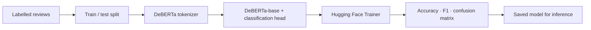

# 🎯 BRIHA · Fine-tuning DeBERTa for Review Classification


     

> ⚡ **Part of [BRIHA](https://github.com/asad110abbas)** · Briha Research, built by Syed Asad Abbas.

End-to-end NLP project: label and explore a customer-review dataset, then **fine-tune Microsoft's
DeBERTa-base transformer** to classify reviews automatically.

## Two notebooks
| Notebook | What it does |
|---|---|
| `Reviews_Classification.ipynb` | **Data preparation & EDA:** text cleaning (NLTK, regex), sentiment labelling, word clouds, Plotly / Seaborn charts, baseline Keras model |
| `Fine_Tuning_Deberta_Base.ipynb` | **Transformer fine-tuning:** tokenization, `AutoModelForSequenceClassification`, Hugging Face `Trainer`, evaluation with scikit-learn metrics |

## Fine-tuning pipeline


## Run
```bash
pip install transformers datasets torch scikit-learn pandas
```
Run `Reviews_Classification.ipynb` first if your data isn't labelled yet, then `Fine_Tuning_Deberta_Base.ipynb`.
A GPU (e.g. Google Colab) is recommended.
